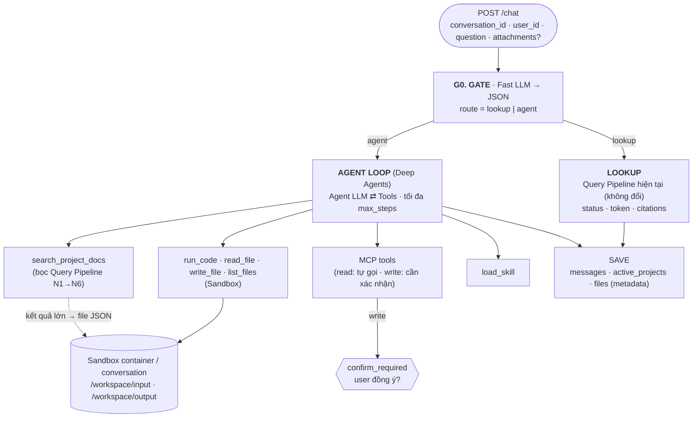

# Spec: Agent Harness

Mục tiêu: cho phép kỹ sư MEP yêu cầu **linh hoạt** (xuất file theo định dạng tùy ý, thao tác nhiều bước, dùng các nguồn/công cụ ngoài qua MCP) thay vì chỉ hỏi đáp text. Câu hỏi tra cứu thuần vẫn đi **đường nhanh** qua Query Pipeline hiện tại (`docs/query-pipeline.md`).

Nguyên tắc:
- Framework: LangGraph. Vòng lặp agent dùng **Deep Agents** (`deepagents`, chạy trên LangGraph); nếu API không phù hợp thì dùng `langchain.agents.create_agent`. **Kiểm tra phiên bản và API thực tế trước khi code**, ghi lại phiên bản đã chốt.
- LLM qua interface chung (`init_chat_model`), không khóa provider. Model đọc từ `config/agent.yaml`.
- **Không sửa** `app/services/query/`, `app/services/ingestion/`, schema dữ liệu. Query Pipeline được tái sử dụng bằng cách gọi graph/hàm có sẵn. Cần đổi → dừng, ghi đề xuất, hỏi lại.
- Phân quyền do **code** ép buộc: `user_id`, `project_id` lấy từ request/state, **không** để LLM truyền vào tham số tool.
- Không có nguồn → không bịa số liệu vào câu trả lời hay file (giữ nguyên quy tắc `NOT_FOUND`).
- Mọi tham số đọc từ `config/agent.yaml`, `config/mcp.yaml`, không hard-code.
- Ngoài phạm vi giai đoạn này: credential vault, chạy theo lịch, lưu trữ file lâu dài, trace/observability (làm sau).

---

## 1. Sơ đồ



---

## 2. Thành phần

### G0. Gate — Fast LLM, structured output
- **In:** câu hỏi, 6 lượt gần nhất, có/không có file đính kèm.
- **Out:** `{route: "lookup" | "agent", reason}`.
- `agent` khi: yêu cầu tạo/xuất file, có file đính kèm, cần nhiều bước (tra cứu + xử lý + tổng hợp), cần tool ngoài (MCP), hoặc tiếp nối một tác vụ agent ở lượt trước.
- `lookup` khi: hỏi đáp tra cứu thông tin tài liệu (như bộ câu hỏi vàng #1–#13).
- Lỗi parse JSON → retry 1 lần → fallback `lookup`.
- Cờ ép tuyến `force_route` trong request (phục vụ test/UI).

### LOOKUP
- Gọi Query Pipeline hiện có, giữ nguyên hành vi, sự kiện SSE và tiêu chí nghiệm thu trong `docs/query-pipeline.md`.

### AGENT LOOP
- Deep Agents (hoặc `create_agent`) với: system prompt (`app/prompts/agent/system.md`), bộ tool ở mục 3, danh sách skill (mục 5).
- Giới hạn (config): `max_steps`, `max_consecutive_tool_errors`, `max_wall_time_s`. Chạm giới hạn → dừng, trả phần đã làm + nêu lý do.
- Quản lý ngữ cảnh:
  - Kết quả tool > `tool_result_max_tokens` → ghi toàn bộ vào sandbox (`/workspace/input/*.json`), chỉ trả LLM bản tóm tắt + đường dẫn file.
  - Ngữ cảnh hội thoại > `summarize_above_tokens` → tóm tắt phần cũ (dùng cơ chế sẵn có của Deep Agents nếu có).
  - Skill nạp theo nhu cầu (mục 5), không nhồi toàn bộ vào system prompt.
- Câu trả lời cuối: text + `citations` (cùng định dạng Query Pipeline) + danh sách file đã tạo.

### Hội thoại & trạng thái
- Lịch sử hội thoại hợp nhất: lượt lookup và lượt agent nằm chung một `messages` (định dạng như Query Pipeline). Agent thấy được các lượt lookup trước và ngược lại (Router của lookup thấy tóm tắt lượt agent).
- Checkpointer: PostgresSaver, `thread_id = conversation_id`. Trạng thái nội bộ của agent (tool calls) lưu namespace riêng, không đẩy vào `messages` hiển thị.
- `active_projects` dùng chung giữa hai tuyến.

---

## 3. Tools

| Tool | Loại | Mô tả |
|---|---|---|
| `search_project_docs(question, project_mentions?, disciplines?, streams?)` | read | Bọc Query Pipeline từ N1 đến N6 (router → resolver → retrieval → rerank → context → grader), **không** chạy N7. Trả: `status`, các block context (id, tài liệu, rev, mục, trang, lang, nội dung đã cắt), `citations`. Kết quả lớn → file JSON trong sandbox. Resolver cần hỏi lại → trả `clarify_options` để agent hỏi user. `user_id` lấy từ state. |
| `run_code(code, timeout_s?)` | sandbox | Chạy Python trong sandbox của conversation. Trả stdout/stderr (cắt ngắn), exit code, danh sách file mới trong `/workspace/output`. |
| `read_file(path)` / `write_file(path, content)` / `list_files(dir)` | sandbox | Chỉ trong `/workspace`. |
| `load_skill(name)` | read | Trả nội dung `SKILL.md` của skill. |
| MCP tools | read / write | Nạp từ `config/mcp.yaml` qua `langchain-mcp-adapters`. Mỗi server/tool khai báo `access: read | write`. Tool không khai báo → coi là `write`. |

Quy tắc:
- Tool `write` (ghi/đẩy dữ liệu ra hệ thống ngoài) → LangGraph `interrupt` → SSE `confirm_required` (tên tool, tham số) → chờ `POST /chat/confirm`. Từ chối → không thực thi, báo agent.
- Mô tả tool viết như prompt: khi nào dùng, khi nào không, ví dụ tham số. Đặt trong code tool, test được.
- Tool lỗi → trả thông báo lỗi có cấu trúc cho agent tự xử lý, không ném exception làm sập vòng lặp.

---

## 4. Sandbox

- **Mỗi conversation 1 container**, tạo lúc lần đầu cần, hủy khi idle quá `idle_ttl_s` hoặc khi conversation bị xóa. Không lưu file lâu dài.
- Interface `SandboxBackend` (`create`, `exec`, `put_file`, `get_file`, `list`, `destroy`) với 2 bản: `DockerSandbox` (Docker SDK; runtime cấu hình được, `runc` mặc định, `runsc`/gVisor khi production) và `MockSandbox` (unit test).
- Image `sandbox/Dockerfile`:
  - Nền Python 3.11; user không phải root.
  - Thư viện: `openpyxl`, `xlsxwriter`, `python-docx`, `python-pptx`, `reportlab`, `pandas`, `matplotlib`.
  - LibreOffice headless (chuyển PDF, kiểm tra file), font tiếng Việt (Noto/DejaVu).
  - Helper công ty: `sandbox/helpers/` (cài thành package `mep_helpers`), template: `sandbox/templates/`.
- Ràng buộc chạy: `network: none`, root filesystem read-only, chỉ ghi được `/workspace` và `/tmp`, giới hạn CPU/RAM/pids, timeout mỗi lần `run_code`.
- Sandbox **không** có thông tin đăng nhập DB/API. Dữ liệu vào sandbox chỉ qua harness (`put_file`).
- File người dùng đính kèm → `/workspace/input/`. File kết quả → `/workspace/output/` → SSE `file` + tải qua API khi sandbox còn sống.

---

## 5. Skills

- Thư mục `skills/<name>/SKILL.md` (frontmatter: `name`, `description`) + script/template đi kèm (nếu có, cài trong image sandbox).
- System prompt chỉ liệt kê `name` + `description`; agent gọi `load_skill` khi cần.
- Skill tối thiểu giai đoạn này:
  - `xlsx-export`: dùng `mep_helpers`, header, cố định dòng tiêu đề, định dạng số, font tiếng Việt, **cột/sheet Nguồn** (tài liệu · rev · mục · trang).
  - `docx-export`: heading, bảng, trích dẫn nguồn cuối tài liệu, font mặc định.
  - `file-check`: sau khi tạo, mở lại file kiểm tra (đọc lại được, đủ dòng/cột, không ô lỗi) trước khi báo xong.
- Ưu tiên định dạng: **yêu cầu của user trong lượt đó > file mẫu user đính kèm > quy tắc mặc định trong skill**.
- Số liệu trong file **phải** lấy từ kết quả `search_project_docs` (hoặc file user cung cấp), không tự điền từ kiến thức chung.

---

## 6. Cấu hình

`config/agent.yaml` (giá trị khởi điểm, chỉnh khi đo):
```yaml
gate:
  llm: fast                 # dùng cấu hình llm.fast trong pipeline.yaml
  history_turns: 6
  json_retry: 1
agent:
  provider: google_genai
  model: gemini-3.8-flash   # nâng model nếu tỉ lệ code lỗi cao
  temperature: 0.1
  max_steps: 25
  max_consecutive_tool_errors: 3
  max_wall_time_s: 300
  tool_result_max_tokens: 4000
  summarize_above_tokens: 60000
sandbox:
  backend: docker           # docker | mock
  image: mep-sandbox:latest
  runtime: runc             # runsc khi production
  cpus: 1
  memory: 1g
  pids_limit: 128
  exec_timeout_s: 60
  idle_ttl_s: 1800
  max_output_file_mb: 20
skills_dir: skills
```

`config/mcp.yaml`: danh sách MCP server (tên, transport, url/command, `access` mặc định, ghi đè theo tool). Secret lấy từ `.env`.

---

## 7. API (bổ sung, giữ tương thích)

- `POST /chat` (SSE): thêm `attachments?` (id file đã upload), `force_route?`. Sự kiện mới:
  - `route` `{route}` · `tool_start` `{tool, args_preview}` · `tool_end` `{tool, ok, summary}`
  - `file` `{name, size, url}` · `confirm_required` `{confirm_id, tool, args}`
  - Giữ nguyên `status`, `token`, `citations`, `done`, `error`.
- `POST /conversations/{id}/files` (multipart): upload file vào `/workspace/input` của sandbox.
- `GET /conversations/{id}/files/{name}`: tải file từ `/workspace/output` (kiểm tra quyền user).
- `POST /chat/confirm` `{conversation_id, confirm_id, approve}` (SSE): tiếp tục lượt đang chờ.
- Frontend (tối thiểu): hiện trạng thái tool, link tải file, hộp xác nhận, nút đính kèm file.

---

## 8. Cấu trúc thư mục

Nguyên tắc: mỗi phần 1 thư mục, mỗi file 1 trách nhiệm (≤ ~300 dòng), phần này gọi phần kia qua interface trong `base.py`/`__init__.py`, không import chéo nội bộ. Test đặt song song theo đúng cấu trúc source.

```
app/services/agent/
  __init__.py            # export build_assistant_graph, stream_assistant_turn
  graph.py               # assistant graph: gate → lookup | agent → save (chỉ wiring)
  state.py               # AssistantState, chuyển đổi messages lookup ⇄ agent
  gate/
    gate.py              # G0: gọi Fast LLM, parse JSON, fallback
    schema.py            # GateOutput
  loop/
    agent.py             # dựng Deep Agents / create_agent, giới hạn bước & thời gian
    context.py           # cắt kết quả tool, đẩy ra file, tóm tắt hội thoại
    confirm.py           # interrupt cho tool write, resume
  tools/
    registry.py          # gom tool theo config, gắn nhãn read/write
    search_docs.py       # search_project_docs (bọc Query Pipeline N1–N6)
    sandbox_tools.py     # run_code, read_file, write_file, list_files
    skill_tool.py        # load_skill
  sandbox/
    base.py              # interface SandboxBackend
    docker_backend.py    # DockerSandbox
    mock_backend.py      # MockSandbox (unit test)
    manager.py           # vòng đời: 1 container / conversation, idle TTL, dọn dẹp
  skills/
    loader.py            # đọc skills/<name>/SKILL.md, frontmatter
  mcp/
    client.py            # nạp MCP server từ config/mcp.yaml (langchain-mcp-adapters)
app/api/routes/
  chat.py                # (sửa) dùng assistant graph, thêm sự kiện SSE mới
  confirm.py             # POST /chat/confirm
  files.py               # upload / download file của conversation
app/models/agent.py      # request/response/SSE event models cho phần agent
app/prompts/agent/       # system.md, gate.md
sandbox/
  image/Dockerfile       # image mep-sandbox
  image/requirements.txt
  helpers/mep_helpers/   # thư viện helper (xlsx, docx, pdf, style) – cài vào image
  templates/             # mẫu file công ty
  Makefile | build.ps1   # build image (Windows dùng build.ps1)
skills/
  xlsx-export/SKILL.md
  docx-export/SKILL.md
  file-check/SKILL.md
config/agent.yaml  config/mcp.yaml
tests/agent/
  unit/{gate,loop,tools,sandbox,skills}/
  integration/sandbox/   # Docker thật + test bảo mật
  e2e/                   # kịch bản A1–A8
tests/fixtures/agent_scenarios.yaml
```

Claude Code tự làm toàn bộ, **kể cả phần sandbox** (Dockerfile, build image, backend, test bảo mật). Thêm service build image vào `docker-compose.yml` (profile `sandbox`), không đổi các service hiện có.

---

## 9. Triển khai (thứ tự)

1. **Sandbox**: image + `SandboxBackend` (Docker, Mock) + `run_code`/file tools. Test bảo mật (mục 10).
2. **Tools**: `search_project_docs` (bọc N1–N6), `load_skill`, MCP loader + phân loại read/write.
3. **Agent loop**: Deep Agents + system prompt + giới hạn + quản lý ngữ cảnh + 3 skill.
4. **Gate + assistant graph**: ghép lookup | agent, lịch sử hợp nhất, checkpointer.
5. **API/SSE + frontend tối thiểu**.
6. **E2E** bộ kịch bản agent (mục 10) + chạy lại bộ câu hỏi vàng lookup (không được giảm điểm).

---

## 10. Test

### Unit (không gọi mạng; mock LLM có tool_calls theo kịch bản, `MockSandbox`)
1. **Gate**: câu tra cứu → `lookup`; "xuất excel…", có đính kèm, "đẩy sang…" → `agent`; JSON lỗi → fallback `lookup`.
2. **Agent loop**: chuỗi tool_calls kịch bản chạy đúng thứ tự; dừng khi hết tool_calls; chạm `max_steps` / lỗi liên tiếp → dừng có thông báo.
3. **Tool `search_project_docs`**: `user_id` lấy từ state (LLM truyền `user_id` bị bỏ qua); dự án không có quyền bị loại; kết quả lớn → ghi file + trả tóm tắt.
4. **Write tool**: phát `confirm_required`; từ chối → tool không chạy; đồng ý → chạy.
5. **Ngữ cảnh**: kết quả tool vượt ngưỡng bị cắt; tóm tắt kích hoạt đúng ngưỡng.
6. **Skills**: đọc frontmatter, liệt kê đúng, `load_skill` trả nội dung.
7. **Lịch sử hợp nhất**: lượt lookup rồi lượt agent rồi lượt lookup — `messages` và `active_projects` đúng.

### Integration (Docker thật)
8. **Sandbox**: tạo/xóa container; `run_code` tạo được xlsx/docx/pdf; font tiếng Việt hiển thị đúng trong PDF.
9. **Bảo mật sandbox**: gọi mạng → thất bại; ghi ngoài `/workspace`, `/tmp` → thất bại; vòng lặp vô hạn → timeout; fork bomb → bị chặn bởi pids; không đọc được biến môi trường chứa key.

### E2E (gọi API thật; dữ liệu S5 đã ingest)
Fixture: `tests/fixtures/agent_scenarios.yaml`.

| # | Yêu cầu | Kiểm tra |
|---|---|---|
| A1 | "Xuất Excel bảng gió tươi S5 (Thuyết minh Bảng 4.3), cột: Khu vực · L/s.người · L/s/m² · Nguồn" | xlsx mở được; có dòng phòng ngủ 2.5 / 0.3, gym 3.8 / 0.9; cột Nguồn đúng tài liệu + trang |
| A2 | "Tạo file Word tóm tắt yêu cầu cáp mục 5.7 Spec Điện: bán kính uốn, tiết diện tối thiểu, màu pha. Font Times New Roman 13" | docx có "6 lần", "1.5mm²", vàng/xanh lá/đỏ; font đúng; có trích dẫn |
| A3 | Đính kèm file mẫu xlsx + "điền thời gian bảo hành và bán kính uốn cáp vào mẫu này" | giữ tên sheet/tiêu đề của mẫu; có 24 tháng, 6 lần đường kính |
| A4 | "So sánh yêu cầu gió tươi của Thuyết minh S5 với Westin, xuất bảng Excel" | nhiều lần `search_project_docs`; có cả 2 nguồn; mục thiếu ghi rõ "không có trong tài liệu" |
| A5 | "Xuất Excel giá trị hợp đồng gói thầu cơ điện" | không bịa số; báo không có trong tài liệu; không tạo file có số liệu giả |
| A6 | Câu hỏi vàng #1 | Gate → `lookup`; không gọi agent; TTFT như Query Pipeline |
| A7 | Yêu cầu dùng 1 MCP tool `write` | có `confirm_required`; từ chối → không thực thi |
| A8 | Yêu cầu tùy biến thêm ở lượt 2: "thêm cột Ghi chú và tô vàng dòng gym" (sau A1) | file mới giữ dữ liệu cũ + thay đổi đúng |

### Tiêu chí nghiệm thu
- Gate phân tuyến đúng ≥ 95% (bộ câu hỏi vàng + kịch bản agent).
- File tạo ra mở được và đúng định dạng yêu cầu ≥ 90% kịch bản.
- Số liệu trong file khớp nguồn 100% với các giá trị kiểm tra; A5 không bịa.
- Không kịch bản nào vượt `max_steps`; thời gian hoàn thành kịch bản tạo file p50 < 90s.
- Bộ câu hỏi vàng của Query Pipeline không giảm điểm so với trước.
- 100% test bảo mật sandbox pass.

## 11. Ngoài phạm vi (bàn sau)
Trace/observability, credential vault, chạy theo lịch, lưu file lâu dài, lưu format người dùng định nghĩa để dùng lại, sub-agent, phân quyền chi tiết theo tool.
