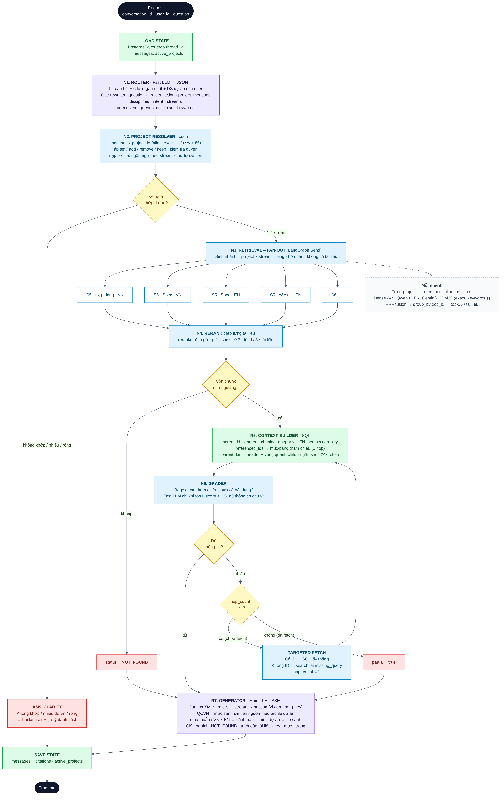
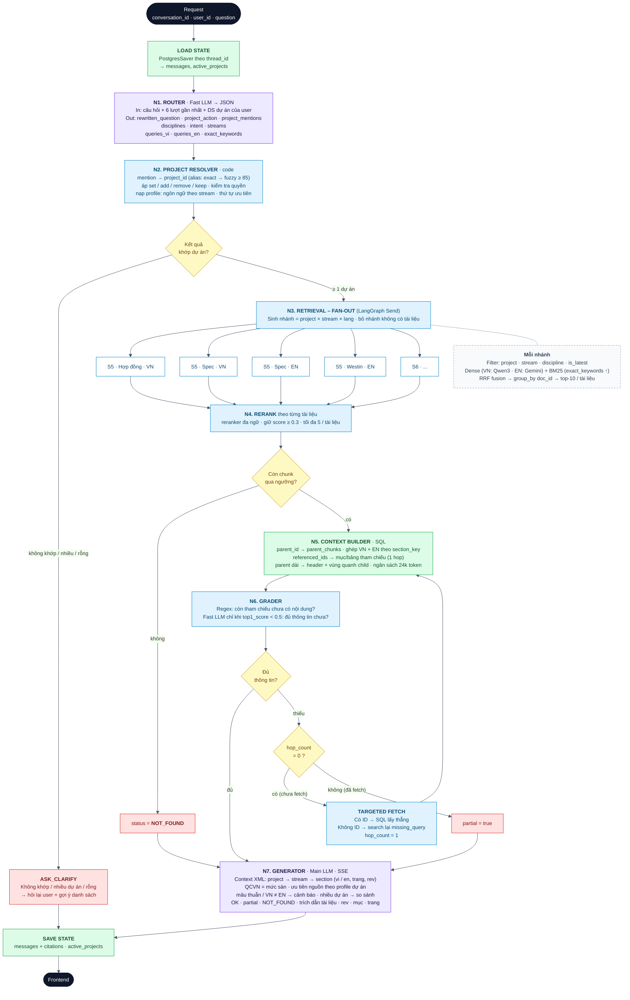

# Spec: Query Pipeline

Mục tiêu: trả lời câu hỏi của kỹ sư MEP **chính xác** (đúng nguồn, đúng revision, có trích dẫn) và **nhanh** (2 lần gọi LLM bắt buộc), trên dữ liệu do Ingestion tạo ra (`docs/ingestion.md`).

Nguyên tắc:
- Framework: LangGraph. LLM qua interface chung (`BaseChatModel` / `init_chat_model`), không khóa provider.
- LLM KHÔNG được tự sinh `project_id`, `doc_id`, `section_key` — mọi ID do code tra cứu.
- Không có nguồn → không trả lời bằng kiến thức chung (status `NOT_FOUND`).
- Mọi tham số đọc từ `config/pipeline.yaml` và `config/models.yaml`, không hard-code.

---

## 1. Sơ đồ





Màu: tím = LLM · xanh dương = code · xanh lá = DB · vàng = rẽ nhánh · đỏ = trạng thái ngoại lệ.

---

## 2. Graph State

| Trường | Kiểu | Ghi bởi | Ghi chú |
|---|---|---|---|
| `messages` | list | LOAD / SAVE | Lịch sử hội thoại (có citations) |
| `user_id` | str | request | |
| `question` | str | request | Câu hỏi gốc |
| `active_projects` | list[project_id] | N2 | Lưu xuyên suốt hội thoại |
| `project_profiles` | dict | N2 | Ngôn ngữ theo stream, thứ tự ưu tiên nguồn, ngôn ngữ ưu tiên hợp đồng |
| `router` | RouterOutput | N1 | Xem N1 |
| `candidates` | list[ChildHit] | N3 | Gộp từ các nhánh (reducer cộng dồn) |
| `reranked` | list[ChildHit] | N4 | |
| `top1_score` | float | N4 | |
| `context` | list[ContextBlock] | N5 | |
| `missing` | list[str] | N6 | Mã tham chiếu / câu truy vấn còn thiếu |
| `hop_count` | int (0/1) | Targeted Fetch | Mặc định 0 |
| `status` | `OK` \| `PARTIAL` \| `NOT_FOUND` \| `ASK_CLARIFY` | N2/N4/N6 | |
| `answer`, `citations` | | N7 | |

Checkpointer: `PostgresSaver`, `thread_id = conversation_id`. Bảng `conversations` (user_id, title, created_at, updated_at) cho UI.

---

## 3. Chi tiết từng node

### LOAD STATE
- **In:** `conversation_id`
- **Logic:** nạp state từ PostgresSaver; hội thoại mới → state rỗng.
- **Out:** `messages`, `active_projects`

### N1. Router — Fast LLM, structured output (JSON)
- **In:** `question`, `router.history_turns` lượt gần nhất, `active_projects` (tên), danh sách dự án user có quyền (tên + alias chính).
- **Logic:** viết lại câu hỏi đủ nghĩa theo lịch sử → phân tích.
- **Out (`RouterOutput`):**
  | Trường | Ví dụ |
  |---|---|
  | `rewritten_question` | "Tiết diện cáp cấp nguồn đèn chiếu sáng sự cố dự án S5 là bao nhiêu?" |
  | `project_action` | `set` \| `add` \| `remove` \| `keep` |
  | `project_mentions` | `["S5", "Bãi Đất Đỏ"]` |
  | `disciplines` | `["ELECTRICAL", "FIRE"]` |
  | `intent_type` | `TECHNICAL_SPEC_LOOKUP` \| `COMPARE` \| `CONTRACT_TERM` \| `STANDARD_LOOKUP` \| `OTHER` |
  | `streams` | `["DESIGN_CONSULTANT", "LEGAL_STANDARD"]` (rỗng = tất cả) |
  | `queries_vi` | `["cáp cấp nguồn đèn chiếu sáng sự cố tiết diện chống cháy"]` |
  | `queries_en` | `["emergency lighting cable cross-sectional area fire resistant"]` |
  | `exact_keywords` | `["1.5mm2", "LSZH", "IEC 60331"]` |
- **Lỗi parse JSON:** retry 1 lần; vẫn lỗi → fallback: `keep`, mọi discipline/stream, `queries_vi = [question]`.

### N2. Project Resolver — code
- **In:** `router.project_mentions`, `router.project_action`, `active_projects`, `user_id`
- **Logic:**
  1. Mỗi mention → chuẩn hóa (lowercase, bỏ dấu, bỏ khoảng trắng/ký tự đặc biệt) → khớp chính xác `project_aliases` → không có thì fuzzy (`rapidfuzz`, ≥ `project.fuzzy_threshold`). Chỉ trong các dự án user có quyền.
  2. Áp action: `set` = thay thế · `add` = thêm · `remove` = bớt · `keep` = giữ nguyên.
  3. Nạp `project_profiles` (cache TTL).
- **Rẽ nhánh:**
  | Nhánh | Điều kiện | Đi tới |
  |---|---|---|
  | A | Có mention không khớp, hoặc 1 mention khớp > 1 dự án | `ASK_CLARIFY` (liệt kê lựa chọn) → SAVE |
  | B | `active_projects` rỗng | `ASK_CLARIFY` (liệt kê dự án của user) → SAVE |
  | C | ≥ 1 dự án | N3 |

### N3. Retrieval — fan-out song song (LangGraph `Send`)
- **Sinh nhánh:** `project × stream × lang`, với stream ∈ `router.streams` (rỗng = tất cả), lang ∈ {vi, en}. **Bỏ nhánh** nếu profile cho biết stream đó không có tài liệu ở lang đó; bỏ lang `en` nếu `queries_en` rỗng.
- **Mỗi nhánh:**
  1. Filter Qdrant: `project_id`, `stream`, `is_latest = true`; phân hệ theo `retrieval.discipline_mode`: `hard` = lọc cứng `disciplines` ∩ (`router.disciplines` ∪ `GENERAL`); `soft` (mặc định từ 2026-11-27) = thêm prefetch có lọc phân hệ bên cạnh prefetch không lọc, RRF cộng điểm tài liệu đúng phân hệ nhưng không loại tài liệu gắn nhãn khác (VD hỏi báo cháy → FIRE, spec báo cháy gắn ELV).
  2. Dense: `queries_<lang>` → model theo `config/models.yaml` (VN: Qwen3 + query instruction · EN: Gemini `RETRIEVAL_QUERY`).
  3. Sparse: BM25 với query + `exact_keywords` (keyword được nhân trọng số `retrieval.keyword_boost`).
  4. Fusion RRF dense + sparse.
  5. `group_by doc_id` → top `retrieval.top_k_per_doc` child / tài liệu.
- **Out:** `candidates` (child_id, parent_id, doc_id, section_key, lang, stream, project_id, text, page, fusion_score).
- Nhánh lỗi/timeout → bỏ nhánh, ghi log, không làm hỏng cả request.

### N4. Rerank — theo từng tài liệu
- **In:** `candidates`, `router.rewritten_question`
- **Logic:** reranker đa ngữ chấm (rewritten_question, child.text). Với mỗi `doc_id`: giữ child có score ≥ `rerank.min_score`, tối đa `rerank.max_per_doc`. Child VN và EN được chấm chung.
- **Giới hạn ứng viên** (cờ từ 2026-11-27, mặc định TẮT): `rerank.max_candidates` > 0 → chỉ chấm top-N ứng viên theo `fusion_score` (RRF theo hạng, so được giữa các nhánh); `rerank.max_candidates_per_doc` > 0 → mỗi tài liệu tối đa k, thiếu chỗ lấp theo fusion. Đo CT05 (N = 120, k = 0, `batch_size` 30): rerank p50 4.8 → 3.9s, hết đuôi 13–17s, số đoạn chấm 390 → 120; câu vàng giữ 95.8% nhưng bộ câu khó 100% → 88.9% (câu hỏi rộng mất mục sát ngưỡng, VD tiêu chuẩn DW/144) nên chưa bật. k = 6 còn tệ hơn (giữ 72% đoạn đạt ngưỡng vì đoạn đúng dồn vào ít tài liệu).
- **Gemini chấm điểm:** lô `batch_size` đoạn gọi song song, trả JSON gọn `{"id": điểm}`; lô chưa xong sau `hedge_after_s` → gửi thêm 1 bản, lấy bản xong trước; quá `max_wait_s` → `missing_score`.
- **Out:** `reranked`, `top1_score`
- **Rẽ nhánh:** `reranked` rỗng → `status = NOT_FOUND` → N7 · ngược lại → N5.

### N5. Context Builder — SQL
- **In:** `reranked` (+ kết quả Targeted Fetch nếu có)
- **Logic:**
  1. Lấy `parent_chunks` theo `parent_id` (distinct), 1 truy vấn.
  2. Ghép parent VN + EN cùng `doc_id + section_key` thành 1 khối (`<vi>`, `<en>`) — **giữ cả hai**, không bỏ bản nào.
  3. `referenced_ids` → lấy parent được tham chiếu trong **các tài liệu đã nạp** (1 hop). Tham chiếu ngoài hệ thống → ghi nhãn "chưa có trong hệ thống".
  4. Parent > `context.max_parent_tokens` (3000, trước 6000 ≈ trần parent khi ingest nên gần như không cắt) → chỉ lấy header/tiêu đề + child trúng ± `context.neighbor_children` child lân cận.
  5. Sắp theo điểm rerank. Khử trùng (`context.dedup_threshold`, 0 = tắt): khối có ≥ ngưỡng shingle 5 từ (VN + EN) nằm trong 1 khối đã giữ của doc/mục khác → bỏ (khối nguồn `priority` nhỏ hơn thay chỗ khối trước). Rồi cắt theo `context.token_budget`.
  6. (`search_payload`, sau khi nạp bảng của mục) `context.drop_heading_only_chars` > 0 → bỏ khối chính chỉ còn tiêu đề (bỏ dòng heading / dòng trùng số-tên mục còn < N chữ/số ở mọi ngôn ngữ, không có bảng), trừ khi kèm khối bảng/tham chiếu hoặc tham chiếu ngoài hệ thống; mọi khối đều là tiêu đề → giữ nguyên.
- **Out:** `context` (mỗi block: project_id, stream, priority, doc title, revision, section_key, title, vi, en, page_start, page_end, is_reference)

### N6. Grader
- **Check 1 – Regex:** các mã tham chiếu xuất hiện trong context (Bảng x.y, Mục x.y, Section 15C, TCVN/QCVN…) mà chưa có nội dung trong context và CÓ trong hệ thống → `missing`.
- **Check 2 – Fast LLM:** chỉ chạy khi `top1_score < grader.llm_check_below`. Hỏi: context có đủ trả lời không? Nếu không → trả `missing_query`.
- **Rẽ nhánh:**
  | Nhánh | Điều kiện | Đi tới |
  |---|---|---|
  | D | Không thiếu | N7 (`OK`) |
  | E | Thiếu & `hop_count = 1` | N7 (`PARTIAL`) |
  | F | Thiếu & `hop_count = 0` | Targeted Fetch → N5 |

### Targeted Fetch
- Có ID trong `missing` → SQL lấy thẳng parent.
- Không có ID → chạy lại N3+N4 thu gọn với `missing_query` (chỉ project/stream hiện tại).
- `hop_count = 1`. Tối đa 1 vòng.

### N7. Generator — Main LLM, streaming SSE
- **In:** `rewritten_question`, `context`, `status`, `project_profiles`
- **Context XML:**
  ```
  <project id="S5">
    <stream name="CONTRACT" priority="1">
      <section doc="..." rev="..." key="sec_5_7" pages="19-20">
        <vi>...</vi><en>...</en>
      </section>
    </stream>
  </project>
  ```
- **Luật trả lời (system prompt):**
  1. Chỉ dùng thông tin trong context.
  2. QCVN là mức tối thiểu bắt buộc.
  3. Ưu tiên nguồn theo `priority` trong profile dự án. Các nguồn mâu thuẫn → nêu cả hai giá trị, chỉ rõ giá trị nào được áp dụng và vì sao.
  4. VN ≠ EN trong cùng mục → cảnh báo, theo ngôn ngữ ưu tiên của hợp đồng (profile).
  5. Nhiều dự án → trình bày/so sánh theo từng dự án.
  6. Mỗi ý có trích dẫn: tài liệu · revision · mục · trang.
  7. `NOT_FOUND` → nói rõ không có trong tài liệu dự án, gợi ý hỏi cụ thể hơn. `PARTIAL` → trả lời phần có + nêu phần thiếu.
- **Out:** stream text + `citations` (doc_id, section_key, page, lang).

### SAVE STATE
- Lưu `messages` (+ citations), `active_projects`. Các trường tạm (`candidates`, `context`…) reset mỗi lượt.

---

## 4. Số lần gọi LLM / request
| Bước | Model | Khi nào |
|---|---|---|
| N1 Router | Fast LLM | Luôn |
| N6 Grader | Fast LLM | Chỉ khi `top1_score` thấp |
| N7 Generator | Main LLM | Luôn (trừ ASK_CLARIFY) |

## 5. API
- `POST /chat` (SSE): `{conversation_id?, user_id, question}` → sự kiện `status`, `token`, `citations`, `done`. Không có `conversation_id` → tạo mới.
- `GET /conversations?user_id=` · `GET /conversations/{id}`

---

## 6. Test

### Unit (không gọi mạng; mock LLM, embedding, reranker)
1. **N2 Project Resolver**: chuẩn hóa alias ("Bãi Đất Đỏ" = "bai dat do" = "BDD"); fuzzy; 1 mention khớp nhiều dự án → ASK_CLARIFY; dự án không có quyền bị loại; bảng chuyển trạng thái:
   | Lượt | action | mentions | active_projects mong đợi |
   |---|---|---|---|
   | 1 | set | S5, S6 | [S5, S6] |
   | 2 | keep | – | [S5, S6] |
   | 3 | set | S5 | [S5] |
   | 4 | add | S7 | [S5, S7] |
   | 5 | remove | S7 | [S5] |
2. **N3 sinh nhánh**: dự án chỉ có VN → không sinh nhánh EN; `streams` rỗng → mọi stream có tài liệu.
3. **N4**: lọc ngưỡng, giới hạn mỗi tài liệu; rỗng → NOT_FOUND.
4. **N5**: ghép VN/EN cùng section_key; loại trùng parent; cắt parent dài; tôn trọng ngân sách token; khử khối gần trùng giữa tài liệu; bỏ khối chỉ có tiêu đề (`tests/query/test_q_quality.py`, cùng giới hạn ứng viên N4).
5. **N6**: regex phát hiện "Bảng 4.3" chưa có nội dung; rẽ đúng nhánh D/E/F; không vượt 1 hop.
6. **N1**: parse JSON lỗi → fallback.
7. **Graph**: chạy đủ 4 đường: OK, PARTIAL, NOT_FOUND, ASK_CLARIFY.

### Dữ liệu test
- Khi phát triển song song: dùng `tests/fixtures/query_seed/` (xem CLAUDE.md, Giai đoạn 2 – phiên B).
- Nghiệm thu: dữ liệu ingest thật từ bộ S5 (Giai đoạn 3).

### Integration / E2E (gọi API thật; dữ liệu đã ingest từ bộ tài liệu S5)
Bộ câu hỏi vàng: `tests/fixtures/s5_golden.yaml`. Mỗi câu: question, expected_section (tài liệu + mục), expected_values (chuỗi phải có trong câu trả lời), expected_status.

| # | Câu hỏi | Nguồn mong đợi | Giá trị mong đợi |
|---|---|---|---|
| 1 | Bán kính uốn cong tối thiểu của cáp tiết diện lớn hơn 25mm² là bao nhiêu? | Spec Điện · 5.7 | 6 lần đường kính ngoài |
| 2 | What is the minimum bend radius for armoured cable? | Spec Điện (EN) · 5.7 | 6 times outside diameter |
| 3 | Tiết diện tối thiểu dây cấp nguồn chiếu sáng không có ổ cắm? | Spec Điện · 5.7 | 1.5mm² |
| 4 | Màu dây pha A, B, C quy định thế nào? | Spec Điện · 5.7 | vàng, xanh lá, đỏ |
| 5 | Thời gian bảo hành hệ thống điện bao lâu? | Spec Điện · 5.23 | 24 tháng |
| 6 | Lưu lượng gió tươi cho phòng ngủ khách sạn S5? | Thuyết minh · Bảng 4.3 | 2.5 L/s.người, 0.3 L/s/m² |
| 7 | Hành lang yêu cầu thông gió bao nhiêu? | Thuyết minh · Bảng 4.3 | 2 ACH |
| 8 | Gió thải toilet công cộng? | Thuyết minh · ASHRAE 62.1 | 25 L/s |
| 9 | U-value kính mặt dựng dùng tính tải lạnh? | Thuyết minh · mục 4 | 5.6 W/m²K |
| 10 | Thiết bị PCCC phải chịu nhiệt độ ngoài trời tối đa bao nhiêu? | Chỉ dẫn PCCC · Chương 1 mục 2 | 40°C |
| 11 | Westin quy định gì cho phòng kỹ thuật MEP? | Westin · 9.7 | (trích dẫn sec_9_7) |
| 12 | Giá trị hợp đồng gói thầu cơ điện là bao nhiêu? | – | status = NOT_FOUND |
| 13 | (hội thoại 2 lượt) "Gió tươi phòng gym S5?" → "Còn lounge thì sao?" | Thuyết minh · Bảng 4.3 | lượt 2: 3.8 L/s.người, 0.9 L/s/m² |

### Tiêu chí nghiệm thu
- Retrieval: `expected_section` có trong `context` ≥ 90% số câu.
- Câu trả lời chứa đủ `expected_values` ≥ 85%.
- Câu #12 trả `NOT_FOUND`, không bịa.
- 100% câu trả lời có trích dẫn hợp lệ (doc + mục + trang tồn tại trong DB).
- Câu #2 chỉ trả lời từ collection `en` hoặc có cả `en`; câu #13 giữ đúng dự án qua 2 lượt.
- Độ trễ (mục tiêu, đo trên bộ vàng): time-to-first-token p50 < 10s (chốt 2026-10-28, trước đó ≤ 4s).

## 7. Ngoài phạm vi (bàn sau)
Eval mở rộng, semantic cache, tóm tắt hội thoại dài, phân quyền chi tiết, UI.
